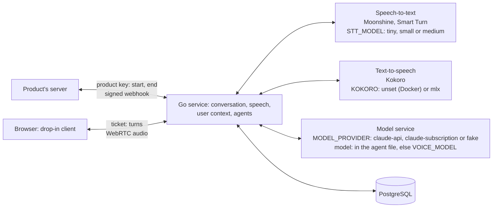
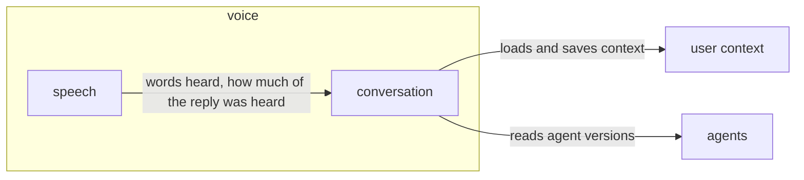
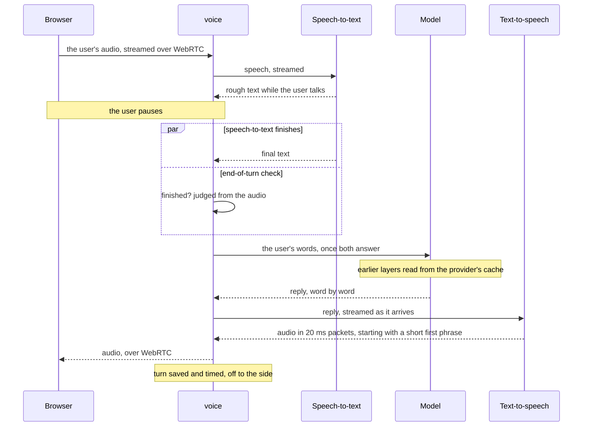
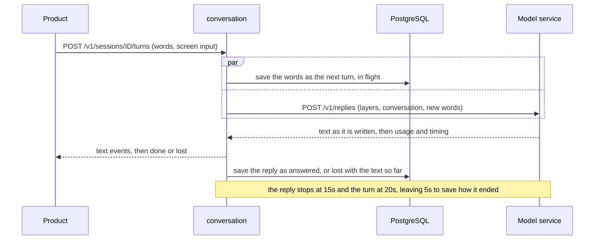

# Architecture

How voice-guide works, in plain words. The complete design, with every decision, failure mode and open question, is [docs/reference/architecture.md](docs/reference/architecture.md): same sections, more detail, and it wins where the two differ.

## 1. Overview

voice-guide is a platform that products embed to give their users AI agents they can talk to. It has three parts:
- voice gives an agent a voice: it listens, decides when the user has finished, gets the agent's answer, speaks it, and times every step.
- User context gives the agent what it may know about the user, and saves what each conversation taught it.
- An agent is just a definition: who it is, how its sessions run, what it reads, how it sounds.

It runs on one machine today, and is designed so that nothing done now blocks growing to many users.

## 2. Purpose

voice-guide lets any product give its users AI agents they can talk to out loud, as naturally as with a person, and that remember them. A product adds voice-guide to its own pages and only defines its agents and what's on its screen; voice-guide handles the rest. Without it, each product rebuilds speech, sessions and memory on its own.

What it is:
- Embeddable: a product adds voice-guide to its own pages through a public API.
- Conversational: replies start quickly, the user can interrupt, and it knows when they've finished.
- Continuous: an agent knows the user from earlier sessions and from other agents.
- Private by default: an agent sees only what it declares.
- Agent-neutral: it decides how a conversation flows, never what's said.
- Measured: every turn is timed, and speed work goes where the time goes.
- Replaceable parts: no model or speech vendor is built in.
- Grows without rework: one machine today, nothing blocks many users.

What it isn't:
- An agent: it has no subject or persona of its own.
- A text chat with voice added: speech comes first, typing is the fallback.

## 3. Scope

Included:
- Starting, ending and resuming sessions.
- Speaking and interrupting.
- Reading past sessions back, for the product's server.
- Seeing and correcting what voice-guide knows about the user.
- Switching agents and being known.
- Per-step timing and load tests.
- Putting an agent on a product: the product's server starts each session with its key, the user's browser talks, and the product's server hears each session once it has ended.

Excluded for now, where it grows next:
- Embedding for anonymous visitors: a public key in the page, for products whose visitors don't log in.
- Agents registered through the API.
- Screen activities: the product's page reaches the agent, and the agent acts on it.
- Connectors that fetch a business's knowledge or a user's data from other systems; until then the product sends what it holds.
- More agents.
- Japanese.
- Logins.
- An agent builder.
- Sharing context with another workspace.

Further out, when measurements call for them:
- A different store for turns.
- Text-to-speech in the browser.

## 4. How it works

The product's server and the user's browser talk to one Go service. The server starts and ends sessions with its product key, and hears each session's end through a signed webhook. The browser takes turns with a ticket for one session. Speech-to-text, text-to-speech and the model each run as their own service behind it (speech-to-text and text-to-speech in containers by default; text-to-speech can run natively on a Mac instead), and PostgreSQL holds everything that must survive.

A box's last lines name the settings that switch it, in `.env` or the agent file.

The Go service has four modules with walls between them, checked on every push. Conversation runs sessions and their turns in text: the prompt, the model's reply, what was said. Speech handles the audio: it turns what the user says into words for conversation and the reply into sound, and tells conversation how much of the reply the user heard. Together they are voice. User context owns what's known about users, and agents holds the agent definitions. Speech calls conversation and never the other way round, so a product without audio can use conversation as it is. Conversation calls user context like any other code, but only user context touches its own tables, and user context never reaches into the others. The API's router, which checks every request's ticket or product key, sits outside the modules and depends on none of them, so each module's HTTP part plugs into it.

Arrows point from the module that calls to the module it calls; nothing calls back the other way.

Inside each module the shape is hexagonal, also called ports and adapters: the core holds the rules and depends on nothing outside it but the modules it may call and the small package that names who a request comes from. The HTTP API, WebRTC, speech, the model and the database plug into the core as adapters, so swapping one touches only that adapter; a new adapter is held to its core's limits until it gets its own.

A turn, from the user's voice to the agent's. Every step streams, so the steps overlap; the user waits only for the pause, the model's first word and the first phrase's audio:

## 5. Qualities

Speed is measured per step, as median and 90th percentile, with no target until there is evidence of where it feels slow. It must also:
- Grow without rework.
- Keep each workspace's data apart.
- Let an agent read only what it declares.
- Answer a repeated request once.
- Keep going in a reduced form when a provider fails.
- Lose nothing on a restart.
- Let other products embed it without changes to voice-guide.

## 6. Platform

Go for the service, PostgreSQL 18 as the only store at first, React with TypeScript in the browser; every part can run in a container (`scripts/up.sh`), and for development the service and the model service, with text-to-speech optionally, run on the machine instead (`scripts/run.sh`). Speech, the model and storage can each be swapped by replacing one adapter, and every swap point has a test fake from day one to prove it; Go and React are the foundations, chosen once. The big rules:
1. No server keeps a conversation in memory, so any instance can serve any turn. A session's audio connection lives on the server that answered it, one per session there; a newer one replaces it, and the replaced tab is told so and stays closed; if one drops, the browser opens a new one with any server.
2. Every record carries its workspace, and every record about a user carries the user too; every query filters by workspace, except a few sweeps the system runs across workspaces, such as ending idle sessions.
3. Slow work runs in the background, never inside a turn: one job queue in PostgreSQL, each job queued in the same write as what calls for it, claimed by whichever instance gets it first, and tried again after a growing wait when it fails. Summaries and deliveries to products run on runners of their own, so a slow product never holds up a summary.
4. Every turn records how long each step took.

A product's server starts each session with its product key, its own ID for the user, the agent, and what it knows about the user, so the product decides who may start a session and what the agent is told. voice-guide keeps only each key's hash and shows a key once. The user's browser carries only a ticket voice-guide signed for that one session, which works until the session ends or for four hours at most, its audio connection included; a product key sent from a page is refused. The product's page loads one script from voice, the drop-in client, to hold the conversation. Errors follow the standard problem details format, and every path starts with `/v1/`. The reference has the full reasoning, including the alternatives rejected.

## 7. Agents

The first agent is deliberately simple: one question at a time, given only the resume the product sends when a session starts. An agent's versions are stored in the database and never change once saved, so a running session keeps the exact version it started with, on whichever server serves it. Until members change agents themselves, the repository holds one file per agent that is published as a new version when it changes. Which model answers is the agent's own choice when its file names one, else a setting of the service. Its file can also name the model that writes its summaries, and a schema of the author's own for a structured part of the summary, such as a score for each area the session covered.

A product puts an agent on its own page with the drop-in client: one script from voice, defining a `<voice-guide-session>` element that the product's page hands the session and ticket its server's start answered with, by a call rather than an attribute, since session-replay scripts copy attributes to their own servers. It holds the session with the same code as voice-guide's own page, without React, sits in the product's page rather than a frame, so the microphone prompt names the product's site and the product restyles it, and it takes no product key and starts no session. It says when the session is over, and why, with an event.

## 8. Sessions

Context comes from three places, by who holds the truth. What the product already knows about the user, such as their resume, it sends when a session starts. What the user is doing on its screen right now, its page hands the drop-in client, which sends each change ahead of the user's next turn, spoken or typed, so their words reach the agent with what they were looking at. What voice-guide learns about the user in conversations, user context keeps. An agent can speak first: its opening, the session's first turn, also warms the model's cache, so the user's first turn isn't the slow one. Until its greeting starts, the page keeps the microphone muted and says so, since speaking into the wait before its first word would cut it off unheard; once it sounds, the user can cut in as on any reply, and typing works throughout. A session ends when the product ends it, as the page's End button does, or after five minutes in which no turn started and the user wasn't heard speaking, since a closed tab never presses End; then it takes no more turns, and a page still open learns of it from its next turn. Ending while the agent speaks cuts its reply where the user stopped hearing it, as interrupting does. Ending one queues a background job that asks the model for a summary, as the agent's own instruction says, and saves it for that agent's next session with the user, which opens knowing what they covered.

When the product has set a webhook, a URL on its server, voice-guide posts each ended session there once its summary is ready: the product's own ID for the user, the turns as the user heard them, and the summary. Each post is signed, so the product's server can tell it came from voice-guide; it is tried again for hours while the server is down, and keeps one ID however often it is sent, so a repeat is dropped.

## 9. Turns

Audio travels over WebRTC because the browser removes the agent's echo from the user's microphone only for audio arriving that way, and interrupting needs the microphone open while the agent speaks. The browser sets the connection up with one HTTP request, sending its offer and getting the server's answer back, as the WHIP standard for streaming does. The page sends the user's microphone, its echo cancellation on, and voice decodes it to 16 kHz in Go; without a microphone, the user types. The stages:
- Speech is detected on the server, by Silero VAD's model run in Go.
- Moonshine turns it into text.
- A pause plus a small model (Smart Turn) decides when the user has finished: the check is asked after 0.2 s of quiet, and after 3 s the turn is taken anyway; a fifth of a second of speech over the agent cuts in.
- The model is called once the check says the user has finished, or the wait is up; calling it earlier, while the check runs, was measured and saved almost nothing.
- Kokoro speaks the reply a phrase at a time: the first ends at the first sentence end, however short, or at another natural break once it holds four words, as does the one after a short first sentence, so speech starts soon, and each next one is made while the one before plays.

Speaking on after the turn was taken, before any of its reply is heard, takes the turn back: what the user adds joins their words, and the agent answers them as one. The page shows the user's words as they are heard, then the reply, and how long after the user finished speaking its first sound went out.

Sending a message while the agent speaks, or talking over it for a fifth of a second, interrupts it: the audio stops, and the turn is saved as far as the user heard it, worked out from the audio already sent, so the agent never builds on words the user didn't hear. The whole reply is kept, and the agent is told the user cut in; what the user says over it becomes their next turn. Anything shorter while the user hears the agent, a click or a breath, lets it speak on and is never sent to the model; said as it finishes, it is the user's turn. One turn's speech runs to a minute at most, then is answered with what was heard.

The prompt is built in layers, stable parts first, so the model reads most of it from cache. What the screen shows reaches the model whole only as it is now, after the cached part; each earlier change stands in the conversation as one fixed line, so a board that changes every turn never makes the model read the conversation again. Each stage can be swapped by changing one setting. Which model answers is a setting too, recorded with every turn, unless the agent's file names its own. The voice and its speed are chosen the same way: a session's start, else the agent's file, else the service's, and kept with the session, so every reply is spoken as the session started.

A typed turn skips the speech stages. The words are saved while the model starts, the reply streams back as it is written, and the reply is saved as it ended:

## 10. User context

User context loads only the kinds of context an agent declares, in the order the agent lists them and newest first, as whole items up to a limit. What a workspace learns about a user stays in that workspace unless the user shares it. Nothing it holds is edited: a corrected summary is saved beside the old one and replaces it, so a conversation already running can tell its copy is out of date.

## 11. History

A product's server reads back its users' past sessions, with its key and no ticket: one call lists a user's sessions, named by the product's own reference, newest first a page at a time, with each one's start, end and summary; another reads one session with all its turns, as the user heard them. A session still running is listed with no end and no summary, another workspace's session is answered as one that doesn't exist, and a user with no sessions has an empty list. A session's transcript and summary also reach the product through its webhook when the session ends.

## 12. Timing and load

Every turn records how long each stage took, stored with the turn. For a spoken reply, from the end of the user's speech: the final text, the end-of-turn check, the turn taken, the model's first text, the first phrase ready and the first audio sent; for every reply, the model's first text and its whole reply. The `measure` skill's scripts reproduce the numbers against the real model and services. On an Apple M3 Pro, with the Claude API and Kokoro on MLX, a spoken reply's first audio goes out a median 1.6 s after the user stops speaking: about 0.4 s to decide the turn is over, 0.6 to 0.8 s more to the model's first words, about 0.25 s until a first phrase is ready, and about 0.25 s to make its audio. Load tests use fakes for the model and speech, so they cost nothing.
