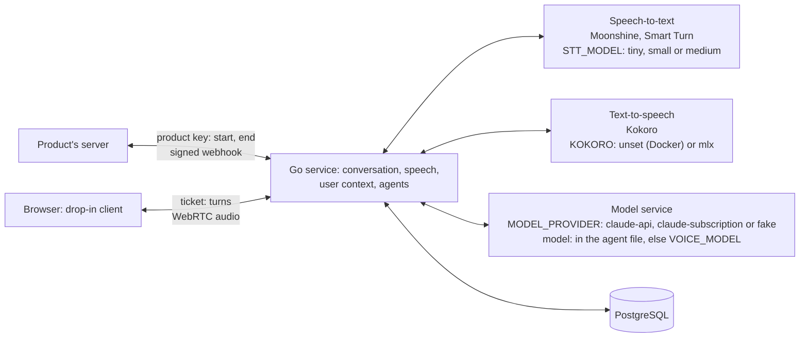

# voice-guide

AI agents your users talk to out loud, embedded in your product, that remember them between sessions.

Early development: English only, runs on one machine, not deployed anywhere yet.

voice-guide is a service that gives an AI agent a voice and the context it needs. It hears the user, works out when they've finished, streams the agent's reply as speech, lets the user cut in, and remembers what the agent learned about this user. Speech-to-text (Moonshine), end-of-turn detection (Smart Turn) and text-to-speech (Kokoro) all run on your machine.

A product, such as a job site, puts an agent on its own page in a few lines of HTML. Its server holds a secret product key and starts each session. The user's browser only ever gets a ticket: a pass for that one session.

- **Talk, don't type.** The agent's reply is spoken as it streams, and typing works throughout.
- **Natural turn-taking.** The agent knows when you've finished, you can interrupt it mid-sentence, and it can open the conversation itself.
- **Agents remember.** When a session ends, the agent writes a summary, and the next session with that user opens with it.
- **Embeds in a product.** The drop-in client puts a `<voice-guide-session>` element on the page, and a signed webhook goes to the product's server with the transcript and summary when a session ends.
- **Agents are Markdown files.** Each holds the agent's persona, the context it needs and how it sums up a session.

<a id="quickstart"></a>
## Quickstart

What you need installed:
- Docker (Docker Desktop or OrbStack), running (`docker info`).
- A Claude API key from the [Claude Console](https://platform.claude.com/), which pays for the replies. Without one you can still run it free, with fake replies.

1. Get the code:

   ```sh
   git clone https://github.com/mikaclements/voice-guide.git
   ```

   ```sh
   cd voice-guide
   ```

2. Start it:

   ```sh
   scripts/up.sh
   ```

   The first run asks for your Claude API key, which you paste unseen (Enter alone gives free fake replies instead), and saves it into `.env`. It then builds and downloads everything, which takes a while the first time. It's ready when it prints `ready: open http://127.0.0.1:5173`.

3. Open http://127.0.0.1:5173 and talk to the mock interviewer, as [the next section](#sample-interviewer) describes.

4. Stop it with Ctrl-C in the same terminal. `scripts/up.sh down` removes the containers; the database keeps your sessions for next time.

<a id="sample-interviewer"></a>
## Test it with the sample interviewer

http://127.0.0.1:5173 is voice-guide's web page. It plays the part of a product: its own small server holds a development product key and starts each session for a sample user, sending their resume. So you can talk to an agent without building anything.

1. Open http://127.0.0.1:5173, pick the mock interviewer, press Start and allow the microphone.
2. It greets you by the resume's name, asks about the resume, and follows up on your answers:
   - your words show as they're heard;
   - once you finish speaking, the reply streams in and is spoken as it arrives;
   - under each reply are its timings: from when you finished speaking to its first sound, or, for the greeting and a typed turn, to its first text and first sound.
3. Mute stops the microphone. Typing works throughout, and sending while the agent speaks cuts it off, as speaking over it does. End finishes the session, and the next one opens with what you covered.

<a id="your-own-data"></a>
### Use your own interviewer and resume

- **The interviewer:** `agents/mock-interviewer.md`, a Markdown file: a settings block between `---` lines, then the persona in plain prose. [Tune it](#tune) lists the settings. Edit it and restart `scripts/up.sh` or `scripts/run.sh`, which publishes the change as a new version.
- **Your resume:** `seed/local/resume.md`, in Markdown or plain text.
- **You, as a user:** `seed/local/reference.txt`, any ID you choose. A new ID is a new user with no past sessions, so the interviewer has no "last time" to open with.

`seed/local/` is git-ignored, so your resume never gets committed. A file you leave out falls back to the invented sample in `seed/placeholder-user/`. Restart `scripts/up.sh` or `scripts/run.sh` after changing them.

[Choose your setup](#setup) explains each option.

<details>
<summary>If you hear nothing, or you aren't heard</summary>

- "first sound" under a reply means the audio reached the browser: check the tab isn't muted, and check the computer's sound output.
- No "first sound" means the audio connection didn't open, or another tab took it. The web page goes on in text; press Start again.
- An earlier run still holding port 8080, 8091 or 5173 answers instead, or stops `scripts/up.sh` or `scripts/run.sh` from starting. Stop it (`lsof -nP -iTCP:8080 -sTCP:LISTEN` shows what holds a port) and start again.
- If what you say isn't heard: the web page shows "Listening" only once the browser has the microphone, so allow it when asked, and check the button doesn't say "Unmute". The log in the script's terminal shows "speech noticed" as you speak. A warning about hearing what you said means the speech-to-text service isn't answering (`docker compose ps stt`).

</details>

<a id="how-it-works"></a>
## How it works



A box's last lines name the settings that switch it, in `.env` or the agent file.

At voice-guide's centre is one Go service, scaled by running more copies. It has four modules:
- **Conversation** keeps sessions and their turns, in text.
- **Speech** runs the audio connection, hearing the user and speaking the agent.
- **User context** loads what an agent may know about the user, and saves what a session learned.
- **Agents** holds the published versions of each agent file.

Conversation and speech together are voice: the part of voice-guide that gives an agent a voice.

<a id="schematic"></a>
**The schematic** is a clickable map of all of it, from the services down to the types in the code, with what flows over every connection and the design decisions behind each part. Each level has walk-throughs to play, such as "You say something" or "A session ends", that light up the parts involved one step at a time. Run `scripts/schematic.sh` (nothing else needs to be running), open http://127.0.0.1:5180, and double-click a card to go down a level.

<a id="embedding"></a>
## Put an agent on a product

A product puts an agent on its page in two halves. Its server starts each session with the product key. Its page holds the conversation with the drop-in client. The page gets only the session's `id` and `ticket`, never the key. `examples/job-board/server.mjs` is a working server half.

`scripts/product-key.sh`, `scripts/webhook.sh` and `scripts/workspace.sh`, below, need Go. They act on the database `scripts/run.sh` uses, not on `scripts/up.sh`'s. So start `scripts/run.sh` before using them: under `scripts/up.sh`, a key `scripts/product-key.sh` made is refused with `401`.

### Start a session from the product's server

The server sends its product key as a bearer credential. `scripts/product-key.sh create` prints a new key, the only time it's shown. On your machine, `VOICE_DEV_PRODUCT_KEY` in `.env` works too, under either `scripts/up.sh` or `scripts/run.sh`. Below, `voice.example.com` stands for where voice-guide runs: http://127.0.0.1:8080 on your machine. Each `<...>` is a placeholder.

```sh
curl https://voice.example.com/v1/sessions \
  -H "Authorization: Bearer <product key>" \
  -H "Content-Type: application/json" \
  -d '{
    "agent_id": "01a1de84-fbfc-7758-9af4-3ced6d8a90cc",
    "request_id": "<a new UUID for each start>",
    "user": "<your own ID for this user>",
    "session_context": [{ "name": "resume", "content": "<resume text>" }],
    "voice": "bf_emma",
    "speed": 1.1
  }'
```

- `agent_id`: the `id` in the agent's file; this one is the mock interviewer. `GET /v1/agents`, with the same key, lists each agent's `id`, `name`, `description` and the `session_context` it needs.
- `request_id`: a UUID the server makes for each start. Sending it again returns the same session, so a retry after a lost reply starts nothing new. A repeat must carry the same `agent_id` and `session_context`, or it is refused with `422` and the problem type `/v1/problems/request-reused`.
- `user`: the product's own stable ID for the user, not a name or an email address. It is at most 200 printable characters, on one line. The same ID is the same user every time, so the agent remembers them.
- `voice` and `speed` (optional): the voice the agent speaks in, such as `bf_emma`, and how fast, from `0.5` to `2` with `1` the voice's own pace. They override the agent file's, which override the server's. `GET /v1/voices` with the same key lists the voices on offer as `{"voices": [...]}`. A voice that isn't a language and a style (`af_heart`), or a speed out of range, is refused with `422` and the problem type `/v1/problems/voice-settings`; a voice not on the list, with `422` and `/v1/problems/unknown-voice`. A start naming a voice while the text-to-speech service can't be reached is refused with `503`; a start naming none never asks it. A repeat keeps the first start's voice and speed, which the reply names.
- `session_context`: what the product already knows about the user, as named text blocks. It holds exactly the names the agent's file lists under `session_context`, each once and not empty. Its blocks hold at most 20,000 characters in all (`VOICE_SESSION_CONTEXT_MAX_CHARS`); more is refused with `413`.

The reply is `201 Created`, or `200 OK` for a repeated `request_id`:

```json
{
  "id": "<session ID>",
  "agent_id": "01a1de84-fbfc-7758-9af4-3ced6d8a90cc",
  "agent_version": 1,
  "voice": "bf_emma",
  "speed": 1.1,
  "started_at": "<RFC 3339 time>",
  "ticket": "<ticket>"
}
```

The server hands its page `id` and `ticket`, and nothing else. A repeat whose session has ended also carries `ended_at`. A repeat past the ticket's four hours has no `ticket`. In either case, start a new session with a new `request_id`.

An error comes as problem details (`application/problem+json`). Its `detail` says what to fix; a `500` has none. A `503` means send the same request again.

The server ends a session with `POST /v1/sessions/<session ID>/end` and the same key. It answers `200` with the session, now carrying `ended_at`, and answers the same to a repeat.

### Hold the conversation on the product's page

The page loads the drop-in client from voice-guide. The client defines the `<voice-guide-session>` element, and the page hands the element the session's `id` and `ticket`:

```html
<button id="start">Practice</button>
<voice-guide-session id="practice"></voice-guide-session>
<script type="module" src="https://voice.example.com/client/voice-guide.js"></script>
<script type="module">
  const element = document.getElementById("practice");
  element.addEventListener("voice-guide-ended", (e) => console.log("over:", e.detail.reason));
  document.getElementById("start").onclick = async () => {
    const { id, ticket } = await (await fetch("/api/practice", { method: "POST" })).json();
    element.join({ session: id, ticket });
  };
</script>
```

The element opens the audio, asks for the microphone, plays the agent and shows the transcript, with typing, Mute and End.
- **Serve the page over https** (or on localhost): the browser offers the microphone nowhere else.
- **Call `join` from the user's own click.** Browsers play sound only after the user has interacted with the page.
- **Pass the ticket only through `join`**, never as an attribute, which session-replay scripts copy to their own servers.

<details>
<summary>The element's methods, events and styling</summary>

| | |
|---|---|
| Methods | `join({ session, ticket })` joins the session, letting any session before go without ending it, as removing the element does. `end()` ends it, as End does: it resolves once voice-guide has ended it, and rejects when End didn't reach voice-guide, which leaves it live |
| Attribute and property | the `api` attribute, voice-guide's base URL, when the script came from somewhere else; the `session` property, the session it holds |
| Events | `voice-guide-ended`, once the session is over for the element: `detail.reason` is `ended`, `expired` (past the ticket's four hours) or `unusable`, with `detail.session`. `voice-guide-error` comes just before an `unusable` end, with `detail.message`, and voice-guide's `status` and problem `type` when it answered |
| Styling | custom properties `--voice-guide-font`, `-color`, `-background`, `-border`, `-radius`, `-accent`, `-accent-text`, `-quiet-color`, `-height`; parts `frame`, `status`, `hear`, `transcript`, `message` (with `you` or `agent`), `who`, `notes`, `note`, `form`, `input`, `send`, `mute`, `end`, styled with `voice-guide-session::part(send)` |

</details>

<a id="webhook"></a>
### Hear when a session ends

`scripts/webhook.sh set <URL>` sets the product's webhook. The first `set` prints the signing secret, the only time it's shown. A later `set` changes the URL and keeps the secret. `scripts/webhook.sh rotate` prints a new secret. The URL must be https, except on localhost or a loopback address, where http works too. Once a session ends and its summary is written, or has failed, voice-guide posts it there as JSON. Three headers come with it: `webhook-id`, `webhook-timestamp` (Unix seconds) and `webhook-signature`.

```json
{
  "id": "<delivery ID, the same as webhook-id>",
  "type": "session.ended",
  "timestamp": "<when the session ended, RFC 3339>",
  "data": {
    "id": "<session ID>",
    "user": "<your own ID for this user, as sent at the start>",
    "agent_id": "01a1de84-fbfc-7758-9af4-3ced6d8a90cc",
    "agent_version": 1,
    "started_at": "<RFC 3339 time>",
    "ended_at": "<RFC 3339 time>",
    "turns": [
      { "seq": 1, "words": "", "reply": "<the agent's greeting>", "cut": false },
      { "seq": 2, "words": "<what the user said>", "reply": "<the reply, as far as the user heard it>", "cut": true }
    ],
    "turns_left_out": 0,
    "summary": "<the agent's summary, or null when none was written>"
  }
}
```

- The opening, the first turn when the agent speaks first, has empty `words`. `cut` says the user interrupted the reply.
- A body holds at most 256 KiB. A longer session leaves out its earliest turns, counted in `turns_left_out`.
- **Check the signature:** the HMAC-SHA256 of `<webhook-id>.<webhook-timestamp>.<raw body>`, keyed with the bytes the base64 after `whsec_` decodes to, is the base64 after `v1,` in `webhook-signature`. This is the Standard Webhooks specification's scheme, so its libraries verify it; `verifyWebhook` in `examples/job-board/server.mjs` does it in Node, and also refuses a timestamp more than five minutes off.
- Answer with any 2xx within 15 s. A slower answer counts as none. Any other answer, or none, is sent again with the same `webhook-id` for about 15 hours, so drop an ID already handled.
- `410 Gone` stops deliveries until the URL is set again. That session, and any that end while deliveries are stopped, are never sent.

<a id="past-sessions"></a>
### Read past sessions

The server reads its users' sessions back with its key, whenever it wants them: for a history page, or to catch up on a session whose delivery it missed. Neither route takes a ticket, so a page can't read them.

```sh
curl "https://voice.example.com/v1/users/<your own ID for this user>/sessions?limit=20" \
  -H "Authorization: Bearer <product key>"
```

The reply lists the user's sessions, newest first, without their turns:

```json
{
  "sessions": [
    {
      "id": "<session ID>",
      "user": "<your own ID for this user>",
      "agent_id": "01a1de84-fbfc-7758-9af4-3ced6d8a90cc",
      "agent_version": 1,
      "started_at": "<RFC 3339 time>",
      "ended_at": "<RFC 3339 time, or null while the session is live>",
      "summary": "<the agent's summary, or null while live or when none was written>"
    }
  ]
}
```

- The user is in the path: percent-encode the ID as one path segment (`encodeURIComponent` in JavaScript), since a raw `/`, `#`, `?` or `%` names something else. An ID a start would refuse is `400` here too. A user the product never started a session for has an empty list.
- `limit` is 1 to 100 (20 without it). For the next page, send `before=<the last session's ID>`; a page shorter than `limit` is the last.
- `GET /v1/sessions/<session ID>` reads one session of the product's workspace with every turn, as a delivery's `data` holds it: the same fields, plus `turns` as the user heard them, and no `turns_left_out`, since the whole session comes back. A long session makes a long reply, about 220 KiB for two hours of talk. Another workspace's session is `404`.
- A live session has `ended_at` and `summary` null, and holds the turns finished so far.

<a id="new-workspace"></a>
### One workspace for each product

Each product gets its own workspace, so its agents, product keys and webhook are its own. `scripts/workspace.sh create <name>` adds one and prints its ID and its first product key, the only time the key is shown. The other scripts act on the workspace in `VOICE_WORKSPACE_ID`, so give them its ID. The product's agent files live in a folder of their own, outside `agents/`, each with its own ID, since an agent's ID is unique across workspaces: `VOICE_AGENTS_DIR=<the product's agents folder> VOICE_WORKSPACE_ID=<ID> scripts/publish.sh` publishes them to it. And `scripts/product-key.sh` and `scripts/webhook.sh` take the same variable. Start `scripts/run.sh` first, as for the scripts above.

<a id="embedded"></a>
## Try it embedded

`examples/job-board/` is the test embedding: a small job board with its own server that puts the mock interviewer on its page through the drop-in client, the way a real product would. Unlike the web page, it also checks the webhook a product receives when a session ends.

### Run it

The test embedding runs beside `scripts/run.sh`, not `scripts/up.sh`. So it needs what [Faster text-to-speech on an Apple silicon Mac](#faster) lists: Docker, Go, Node and OpenSSL. `scripts/webhook.sh` runs with Go, and `scripts/demo.sh` runs the job board's server with Node. You also add one line to `.env` by hand.

1. Start voice-guide with `scripts/run.sh` and leave it running.
2. In another terminal, set the [webhook](#webhook), the address where voice-guide tells the test embedding that a session has ended. The first `set` prints the webhook's signing secret, only once. If the workspace has a webhook already, `set` keeps its secret, and `scripts/webhook.sh rotate` prints a new one:

   ```sh
   scripts/webhook.sh set http://127.0.0.1:5190/webhook
   ```

3. Open `.env` in an editor and add the line `JOB_BOARD_WEBHOOK_SECRET=whsec_...` with that secret.
4. Serve the test embedding and open http://127.0.0.1:5190:

   ```sh
   scripts/demo.sh
   ```

### Use your own data

The test embedding uses the same resume and user as the web page: see [Use your own interviewer and resume](#your-own-data). Restart `scripts/demo.sh` after changing them.

### What it tests

The test embedding exercises the contract between a product and voice-guide, end to end:

1. **The key stays on the product's server.** The test embedding's server holds the product key and starts the session. The page receives only the session's ID and its ticket.
2. **The product sends what it already knows.** The server names the user by its own ID and sends their resume. voice-guide checks the resume against what the agent's file asks for, and the interviewer asks about it.
3. **A ticket works for one session.** It stops when the session ends, or after four hours.
4. **The embedding is a few lines.** The page loads the drop-in client from voice-guide and hands its element the session and ticket.
5. **The agent opens the conversation.** The microphone stays muted until the greeting starts, so a "hello" into the silence can't cut it off. From then on, the user can interrupt.
6. **The conversation is spoken.** You speak, pause, and the interviewer answers out loud; the transcript follows the newest line.
7. **The product hears the end.** When the session ends, voice-guide posts the transcript and the summary to the test embedding's webhook, signed, and the page shows the interview feedback.
8. **The agent remembers.** Start another interview: the interviewer opens with what you covered last time.

It doesn't test accounts, since every visitor is the same user; a real product names its logged-in user. Nor does it test a hosted deployment.

<a id="faster"></a>
## Faster text-to-speech on an Apple silicon Mac

`scripts/run.sh` runs the Go service, the model service and the web page on the Mac itself, with the database and speech-to-text in Docker. It's the path for developing voice-guide, and the way to faster text-to-speech: Kokoro on the Mac's GPU through Apple's MLX. It keeps a database of its own, apart from `scripts/up.sh`'s, and uses the same ports, so stop `scripts/up.sh` first.

What you need installed, besides Docker:
- [Go](https://go.dev/dl/), the version in `go.mod`, which builds the Go service (`go version`).
- Node 26, the version in `.node-version`, for the model service and the web page (`node --version`).
- OpenSSL, which makes the local signing keys (`openssl version`; macOS has it).
- For faster text-to-speech: an Apple silicon Mac (M1 or later) on macOS 14 or later, and [uv](https://docs.astral.sh/uv/) (`brew install uv`, or without Homebrew `curl -LsSf https://astral.sh/uv/install.sh | sh`).

Start it with one of these:

Any Mac:

```sh
scripts/run.sh
```

Apple silicon Mac, faster text-to-speech:

```sh
KOKORO=mlx scripts/run.sh
```

The first run asks for the Claude API key as `scripts/up.sh` does, unless `.env` has one already. It takes a few minutes. It's ready when it logs `ready: open http://127.0.0.1:5173`. Stop it with Ctrl-C in the same terminal.

`KOKORO=mlx` on the command line lasts one run, unless that run creates `.env`, as [Choose your setup](#setup) explains. To keep the faster text-to-speech, add the line `KOKORO=mlx` to `.env`. Remove it to go back to Kokoro in Docker.

<a id="setup"></a>
## Choose your setup

Two ways to start:
- `scripts/up.sh` ([Quickstart](#quickstart)): everything in Docker. Replies from `claude-api` or `fake`; text-to-speech from Kokoro in Docker.
- `scripts/run.sh` ([Faster text-to-speech on an Apple silicon Mac](#faster)): every option below, `claude-subscription` and `mlx` included.

Two settings decide where the replies come from and where text-to-speech runs. Times were measured on an Apple M3 Pro.

Where replies come from, `MODEL_PROVIDER`:
- `claude-api` (default): Claude through its API, billed to your `ANTHROPIC_API_KEY`, about a fifth of a cent a turn on Sonnet 5.5. The fastest: its first words come in about 0.7 s.
- `claude-subscription`: Claude Code signed in on this Mac, so replies count against your Claude subscription and need no key. About 1.6 s, varying by the hour.
- `fake`: no Claude; every reply, the greeting included, is the same set line. Free, for trying everything else; Enter at the key prompt picks it.

Where text-to-speech runs, `KOKORO`:
- `mlx` (recommended on Apple silicon): Kokoro on this Mac's GPU through Apple's MLX. Needs uv; 0.9 GB the first time, in `~/Library/Caches/voice-guide/`, and about 0.7 GB of memory. First audio in about 0.5 s.
- unset (any Mac): Kokoro in Docker, on the CPU. Needs nothing more; 4.5 GB the first time. First audio in about 1.2 s.

The model is the one the agent file names with `model:` (the mock interviewer names `claude-sonnet-5-5`), else `VOICE_MODEL`.

End to end, a reply starts about 1.6 s after you stop talking with the API and `mlx` on Sonnet 5.5 (1.4 s on Haiku 5.5), and about 2.6 s with the subscription and Docker.

The run of `scripts/up.sh` or `scripts/run.sh` that creates `.env`, usually the first, saves `ANTHROPIC_API_KEY`, `KOKORO` and `MODEL_PROVIDER` given or exported in your shell into it. Later runs use a setting given in the shell for that run only. To change a setting for good, edit `.env` and restart the script. A key exported in your shell wins over the one in `.env`, and the scripts say so when they differ.

<a id="tune"></a>
## Tune it

Everything runs on defaults, some measured and some round guesses. Change any of them in `.env` (a value on the command line wins), then restart `scripts/up.sh` or `scripts/run.sh`:

| Setting | Default | What it changes |
|---|---|---|
| `VOICE_MODEL` | `claude-sonnet-5-5` | The model that answers for agents whose file names none |
| `MODEL_PROVIDER` | `claude-api` | Where replies come from: see [Choose your setup](#setup) |
| `KOKORO` | unset | Where text-to-speech runs: unset (Docker) or `mlx`; see [Choose your setup](#setup) |
| `VOICE_TTS_VOICE` | `af_heart` | Kokoro's voice for sessions that name none, at its own pace |
| `STT_MODEL` | `small` | Speech-to-text's model size: `tiny`, `small` or `medium` |
| `VOICE_PAUSE` | 0.2 s | How long a pause in your speech before voice-guide checks whether you've finished |
| `VOICE_MAX_WAIT` | 3 s | How long voice-guide waits for more when that check says you haven't finished |
| `VOICE_INTERRUPT_SPEECH` | 0.2 s | How long you must speak over the agent before it stops |
| `VOICE_SPEECH_THRESHOLD` | 0.5 | How sure speech detection must be that a sound is speech |
| `VOICE_MAX_SPEECH` | 1 min | The longest one turn of speech |
| `VOICE_TURN_TIMEOUT` | 20 s | The longest a reply may take |
| `VOICE_SESSION_IDLE` | 5 min | How long a session sits with no turn or speech before it ends |

The agent itself is tuned in its file, `agents/mock-interviewer.md`. A settings block comes first:
- `id`, `name` and `description`: which agent it is; a product's server names it by `id` when it starts a session;
- `opens`: who speaks first, `agent` or `user`;
- `reads`: what the agent may know about the user from earlier sessions;
- `session_context`: what the product must send at the start, such as the resume;
- `summary`: how the agent sums up a session for next time;
- `model`: the model that answers its turns and writes its summary, the server's `VOICE_MODEL` unless set;
- `voice` and `speed`: the voice its replies are spoken in, and how fast, `0.5` to `2`, the server's own unless set.

The persona follows it, in plain prose. `scripts/up.sh` and `scripts/run.sh` publish a changed file as a new version when they start; sessions already running keep the version they started with.

<a id="development"></a>
## Contributing

[CONTRIBUTING.md](CONTRIBUTING.md) covers setting up for development, the checks (`scripts/check.sh` runs every check CI runs), the commands and where everything lives. [ARCHITECTURE.md](ARCHITECTURE.md) explains how voice-guide works, in plain words, and `docs/reference/` holds the complete design and standards.

## Licence

Licensed under the Apache License 2.0 ([LICENSE](LICENSE)). Copyright 2026 Mika Clements.
